# AI & ML Learning Lab




Welcome to my AI & ML Learning Lab — a personal workspace for learning, experimentation, and building practical machine learning and deep learning projects.

This repository documents my learning journey through model development, data preprocessing, experimentation, evaluation, and deployment. It will continue to grow as I explore more areas of AI and machine learning.

## Featured Projects

| Project | Description | Status | Links |
|---|---|---|---|
| Customer Churn Prediction — ANN | Artificial neural network for customer churn classification | Deployed | [Live Demo](https://customer-churn-ann-ap.streamlit.app/) · [GitHub Repository](https://github.com/chandrasekhar888/Customer_Churn_ANN) |
| IMDb Sentiment Analysis — RNN | Recurrent neural network for sentiment classification of movie reviews | Deployed | [Live Demo](https://imdb-sentiment-rnn-ap.streamlit.app/) · [GitHub Repository](https://github.com/chandrasekhar888/Customer_Churn_ANN) |
| Hamlet Next-Word Prediction — LSTM | Predicts subsequent words using an LSTM trained on Shakespeare's *Hamlet* | Deployed | [Live Demo](https://ai-ml-learning-lab-dtrdnbqkrupw2cdps9tjjo.streamlit.app/) · [Source Code](LSTM/) |

## Project Details

### 1. Customer Churn Prediction — ANN

A deep learning project that uses an artificial neural network to predict customer churn.

- **Technology:** Python, TensorFlow/Keras, Streamlit
- **Objective:** Predict whether a customer is likely to leave a service.
- **Deployment:** Streamlit Community Cloud

[Open Live Demo](https://customer-churn-ann-ap.streamlit.app/) · [View Repository](https://github.com/chandrasekhar888/Customer_Churn_ANN)

### 2. IMDb Sentiment Analysis — RNN

A natural language processing project that uses a recurrent neural network to classify movie-review sentiment.

- **Technology:** Python, TensorFlow/Keras, NLP, Streamlit
- **Objective:** Predict sentiment from review text.
- **Deployment:** Streamlit Community Cloud

[Open Live Demo](https://imdb-sentiment-rnn-ap.streamlit.app/)

The sentiment-analysis project is currently linked to the existing `Customer_Churn_ANN` repository. If its source code is maintained in a separate repository, update that link to the correct repository.

### 3. Hamlet Next-Word Prediction — LSTM

A language-modeling project that predicts the next word in a sequence using an LSTM trained on Shakespeare's *Hamlet*, obtained through the NLTK Gutenberg corpus.

- **Technology:** Python, TensorFlow/Keras, NLTK, NumPy, Streamlit
- **Data preprocessing:** Tokenization, progressive n-gram sequence generation, and pre-padding.
- **Model:** Embedding layer followed by LSTM layers and a softmax output layer.
- **Prediction:** Generates subsequent words from user-provided text.
- **Interface:** Streamlit application.
- **Deployment:** Streamlit Community Cloud.

**Try the application:** [Hamlet Next-Word Prediction — Live Demo](https://ai-ml-learning-lab-dtrdnbqkrupw2cdps9tjjo.streamlit.app/)

The current model demonstrates the complete next-word prediction workflow. Training showed overfitting and low validation accuracy, so improving prediction quality remains a future task.

The repository also contains a GRU notebook for future experimentation and comparison with the LSTM approach.

## Why This Repository Exists

This repository brings together:

- Deep learning and machine learning experiments.
- Data preprocessing and model-training notebooks.
- Natural language processing projects.
- Deployed applications and interactive demos.
- Reusable learning notes and project documentation.
- Future work involving transformers, generative AI, and MLOps.

The goal is to maintain a clear, reproducible, and continuously improving AI/ML portfolio.

## Technology Stack

| Area | Technologies |
|---|---|
| Programming | Python |
| Deep Learning | TensorFlow, Keras |
| Machine Learning | scikit-learn |
| Natural Language Processing | NLTK |
| Data Processing | NumPy |
| Development | Jupyter Notebook, VS Code |
| Applications | Streamlit |
| Version Control | Git, GitHub |

## Repository Structure

```text
AI_Projects_Practice/
├── LSTM/
│   ├── app.py
│   ├── data_collection_preprocessing.ipynb
│   ├── next_word_gru.ipynb
│   ├── next_word_lstm.ipynb
│   ├── README.md
│   └── requirements.txt
├── assets/
│   └── ai-lab-banner.svg
├── .gitignore
└── README.md
```

The root README documents the overall portfolio. Each project can maintain its own README with project-specific details, setup instructions, and implementation notes.

## Running the LSTM Project Locally

### Prerequisites

- Python 3.11
- Git
- A virtual environment
- The trained LSTM model and tokenizer files required for inference

### 1. Clone the repository

```bash
git clone https://github.com/chandrasekhar888/ai-ml-learning-lab.git
cd ai-ml-learning-lab
```

### 2. Create and activate a virtual environment

From the repository root, using Windows PowerShell:

```powershell
python -m venv LSTM/.venv
.\LSTM\.venv\Scripts\Activate.ps1
```

### 3. Install dependencies

```powershell
python -m pip install -r LSTM/requirements.txt
```

### 4. Run the Streamlit application

```powershell
cd LSTM
streamlit run app.py
```

**Note:** The trained model (`next_word_lstm.keras`) and tokenizer (`tokenizer.pickle`) are excluded from Git by the repository's ignore rules. They must be supplied separately for local inference unless you regenerate them by running the training workflow. The generated preprocessing file `preprocessed_data.pkl` is not required to run predictions with an already trained model and tokenizer.

## Reproducing the LSTM Workflow

The notebooks document the model development process:

1. Collect the Shakespeare text using the NLTK Gutenberg corpus.
2. Preprocess the text and tokenize words.
3. Generate progressive n-gram sequences.
4. Pad sequences to a consistent length.
5. Train the LSTM model to predict the next word.
6. Evaluate model performance.
7. Save the trained model and tokenizer.
8. Run predictions through the Streamlit interface.

For corpus preparation, the NLTK Gutenberg corpus may need to be downloaded:

```python
import nltk

nltk.download("gutenberg")
```

Training and preprocessing outputs are generated locally rather than committed to the repository.

## Current Project Status

- **Customer Churn Prediction — ANN:** Deployed and available through its Streamlit demo.
- **IMDb Sentiment Analysis — RNN:** Deployed and available through its Streamlit demo.
- **Hamlet Next-Word Prediction — LSTM:** Model training and prediction logic implemented; Streamlit app deployed and working.
- **GRU:** Follow-up experiment planned for comparison with the LSTM model.
- **Model improvement:** Further evaluation and reduction of overfitting remain future goals.

## Future Learning Roadmap

1. Strengthen machine learning and deep learning fundamentals.
2. Explore attention mechanisms and transformer architectures.
3. Build more NLP projects, including text classification and language modeling.
4. Improve model evaluation, generalization, and explainability.
5. Develop reproducible training and deployment pipelines.
6. Explore generative AI, large language models, retrieval-augmented generation (RAG), and AI agents.
7. Expand deployment experience with Streamlit, APIs, containers, and cloud platforms.

## Dataset and Generated Artifacts

To keep the repository focused on source code and documentation, the following local files are excluded from Git:

- Python virtual environments and cache files.
- Trained model files such as `.h5` and `.keras`.
- Serialized tokenizer files such as `.pickle`.
- Generated preprocessing data such as `preprocessed_data.pkl`.
- The locally generated `hamlet.txt` corpus file.

The notebooks and documentation describe how to reproduce the preprocessing and training workflow. A deployed application must still have access to the specific model and tokenizer it needs for inference.

## Contact and Portfolio

This repository is my evolving portfolio for applied AI and machine learning. It is organized to make existing projects easy to explore while leaving room for future experiments and applications.

Thank you for visiting my AI & ML Learning Lab!
